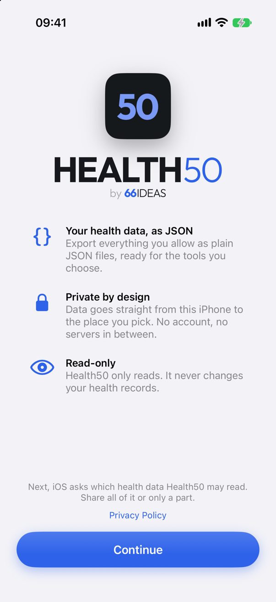
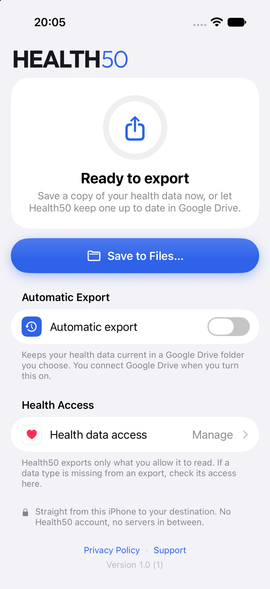
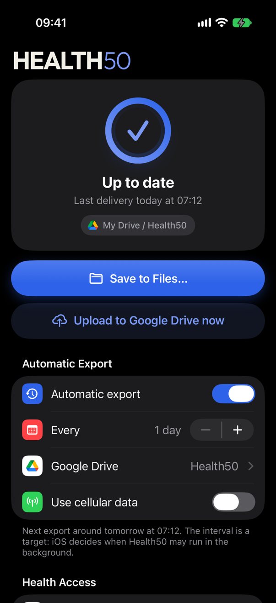
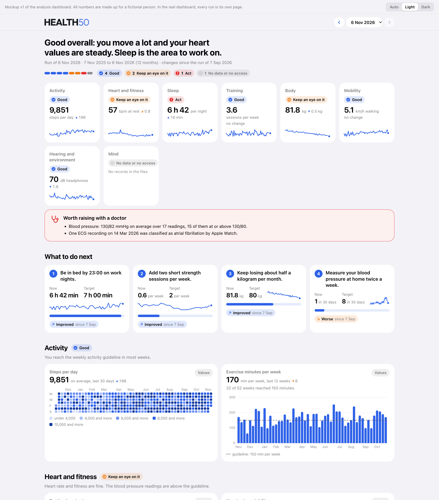

<p align="center">
  <picture>
    <source media="(prefers-color-scheme: dark)" srcset="assets/health50-by-dark.svg">
    
  </picture>
</p>

<p align="center">
  <a href="LICENSE"></a>
  <a href="specs/specifications.md"></a>
  <a href="dev/README.md"></a>
  <a href="https://66ideas.com"></a>
</p>

**HEALTH50 is a free, open-source way to get your Apple Health data out of your
iPhone and to understand it.** It has two parts: an iPhone app that exports the
health data you choose as plain JSON files, and a skill for an AI assistant that
analyses those files on your computer and tells you how your health is and what
you can do to improve it.

Your data goes straight from your iPhone to the place you pick. There is no
Health50 account, no server and no analytics.

The idea, in one line: **the specification is the product; the code is the proof.**
The specifications describe what Health50 does, how it looks and how it is built.
The code in this repository is the reference implementation of them.

## State of the project

| Part | State |
|---|---|
| iPhone app | Implemented and tested on an iPhone. Not in the App Store yet; for now you build it yourself. |
| Export format | Version 1, approved. |
| Analysis skill | First version. It runs from the exported files to the chat result and the dashboard. The guideline values are not yet checked against their sources, and it has been tested with the data of one person only. |

## The iPhone app

<p align="center">
  
  
  
</p>

- **Save to Files:** the last 30 days, the last 12 months or your full accessible
  history in one JSON file, in a file location you pick.
- **Automatic export:** one JSON file per month in a folder of your own Google
  Drive, kept current in the background. Only the months that changed are
  uploaded again.
- **Everything Health holds:** 121 quantity types and 71 category types, plus
  workouts with routes, blood pressure, ECGs, heartbeat series, audiograms,
  states of mind, questionnaires, activity rings and your profile. Clinical
  records are not part of version 1.
- **You decide what is exported:** Health50 exports only what you allow it to
  read, and it only reads. It never changes your health records.
- **One screen:** a status card, one button, one switch. No tabs and no settings
  to hunt for.
- **Six languages:** English, German, French, Spanish, Italian and Japanese.
- **Free:** no price, no purchases, no advertising.

The app is native: Swift 6 and SwiftUI for iOS 27, with no third-party code.

## The export format

The files are plain JSON that reads without the app: clear key names, Apple's own
identifiers for the data types, a unit on every value, and the dates, source and
extra context on every record. Each file stands on its own.

```json
"HKQuantityTypeIdentifierHeartRate": { "unit": "count/min", "samples": [
{ "id": "6F1C…", "start": "2026-11-05T05:58:12Z", "value": 58, "source": "s1" }
] }
```

One record per line, so even a history of several gigabytes can be read line by
line with a few lines of code in any language. The full description is in
[specs/export-format.md](specs/export-format.md).

## The analysis skill

The skill is in [`skill/health50-analysis/`](skill/health50-analysis/). It turns a
folder of Health50 files into a short result in the chat and a visual dashboard.



<p align="center"><sub>The dashboard mockup. All numbers in it are made up for a fictional person.</sub></p>

- **Eight areas:** activity, heart and fitness, sleep, training, body, mobility,
  hearing and environment, and mind. Each one gets a rating: good, keep an eye on
  it, or act.
- **Judged twice:** against your own earlier values and against published
  guidelines. Every guideline used is named with its source.
- **Three to five recommendations:** each one tied to your own numbers, with a
  measurable target. The next run shows whether the number moved towards it.
- **A dashboard per run:** one self-contained HTML page with charts, light and
  dark appearance, readable on a computer and on a phone. It loads nothing from
  the internet. The dashboards of all runs are linked, so you can follow your
  progress.
- **A coach, not a doctor:** lifestyle recommendations only. No diagnosis and no
  advice on medication. Findings that can be serious are named and referred to a
  doctor.

How it works: a script reads the files on your computer and reduces them to a
compact summary. It counts a record that is in several files once and picks one
source where several devices recorded the same thing. The AI assistant reads only
that summary, never the raw records, and writes the ratings and recommendations.
A second script builds the dashboard.

| File | Purpose |
|---|---|
| [`SKILL.md`](skill/health50-analysis/SKILL.md) | The instructions for the AI assistant: the steps of a run, how to rate an area, how to choose recommendations, and the limits |
| [`references/`](skill/health50-analysis/references/) | What the numbers mean and the format of the findings file |
| [`scripts/summarize.py`](skill/health50-analysis/scripts/summarize.py) | Reads all Health50 files of a folder and writes the summary. Python standard library only. A history of more than ten years (2.5 GB) takes a few seconds. |
| [`scripts/digest.py`](skill/health50-analysis/scripts/digest.py) | Prints the part of the summary the AI assistant reads, with the goals, the guidelines and the previous run |
| [`scripts/build_dashboard.py`](skill/health50-analysis/scripts/build_dashboard.py) | Builds the dashboards of all runs from their summary and findings |
| [`assets/dashboard-template.html`](skill/health50-analysis/assets/dashboard-template.html) | The page template of the dashboard |
| [`guidelines.json`](skill/health50-analysis/guidelines.json) | The guideline values the skill may use, with their sources. Draft, not yet checked against the sources. |

The summary, the findings and the dashboard are stored next to your exported
files, in a subfolder `analysis/`. Nothing about your health is stored anywhere
else.

## Get started

### Build the app

Requires Xcode 27 or later and an iPhone or simulator with iOS 27.

```bash
git clone https://github.com/66IDEAS/HEALTH50.git
```

Open `dev/Health50.xcodeproj` in Xcode and run the `Health50` scheme. Automatic
export to Google Drive needs a Google client ID of your own; "Save to Files"
works without one. See [dev/README.md](dev/README.md) for both.

### Use the analysis skill

Requires Python 3, which macOS and Linux bring along, and an AI assistant that
supports skills, for example Claude Code. Copy the skill folder into the skills
folder of your assistant:

```bash
cp -R skill/health50-analysis ~/.claude/skills/
```

Then export your data with the app into a folder on your computer and ask your
assistant: "How is my health?" On the first run the skill asks for that folder
and, optionally, for your goals. Every later run starts right away and shows
what changed since the run before.

## Repository layout

| Path | Content |
|---|---|
| [`specs/`](specs/) | **The product.** Functional specification, UX specification, architecture, export format, mockups and task list |
| [`dev/`](dev/) | **The proof.** The iPhone app: Swift 6 and SwiftUI for iOS 27 |
| [`skill/health50-analysis/`](skill/health50-analysis/) | The analysis skill: scripts, dashboard template and guidelines |
| [`assets/`](assets/) | Logo and screenshots for this page |
| [PRIVACY.md](PRIVACY.md) | Privacy policy of the app |
| [SUPPORT.md](SUPPORT.md) | Help and common questions |

## The specification

- [Functional specification](specs/specifications.md): twelve user stories with
  acceptance criteria. Stories 1 to 6 describe the app, stories 7 to 12 the
  analysis skill.
- [UX specification](specs/ux.md): 41 requirements for the single screen of the
  app, the chat result and the dashboard.
- [Mockups](specs/mockups): HTML mockups of the app's screen and of the dashboard.
- [Architecture](specs/architecture.md): 20 decisions, among them one file per
  month in Google Drive, Google sign-in without a server, and how the skill
  counts correctly.
- [Export format](specs/export-format.md): the JSON format of the exported files.
- [Task list](specs/tasks.md): implementation tasks, their state, and the errors
  found on the way.

The specifications are written to be read by people and by AI agents: the
acceptance criteria are concrete and nothing depends on knowledge that is not
written down.

## Privacy

- The app has no servers and no user accounts. 66IDEAS never receives your health
  data.
- The app reads only the health data you allow, and it only reads.
- Your data leaves your iPhone only when you export it, and only to the place you
  choose: a file location you pick, or your own Google Drive. There the app can
  only work with the files and folders it created itself or that you picked.
- The analysis skill reads the exported files on your computer only. The compact
  summary, and your goals if you state them, are given to the AI assistant you
  run the skill with, and so to the provider of that assistant.

The full policy of the app is in [PRIVACY.md](PRIVACY.md).

## Help and contributing

Questions, problems and ideas are welcome as
[issues](https://github.com/66IDEAS/HEALTH50/issues), on the specifications as
well as on the code. Common questions are answered in [SUPPORT.md](SUPPORT.md).

**Never post health data or export files in an issue.** A description of what
you did and what happened is enough.

## License

[MIT](LICENSE) - free to use, modify and distribute, including commercially.

---

<p align="center"><sub>A <a href="https://66ideas.com">66IDEAS</a> product · WENIGER. ABER BESSER.</sub></p>
